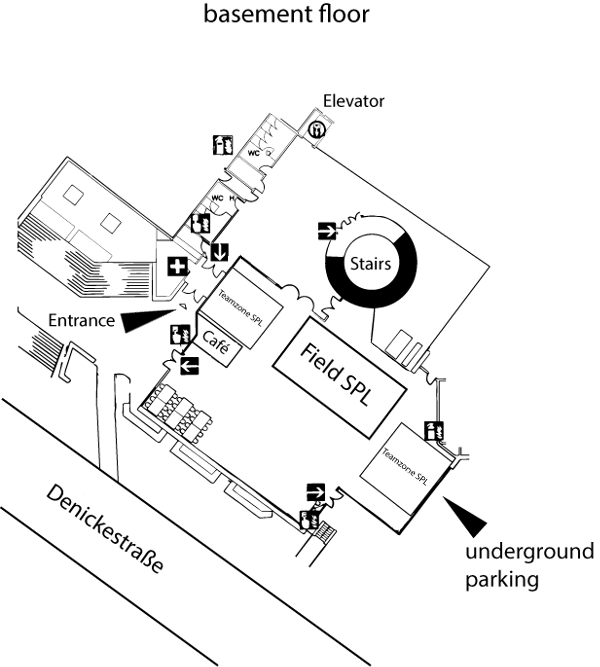
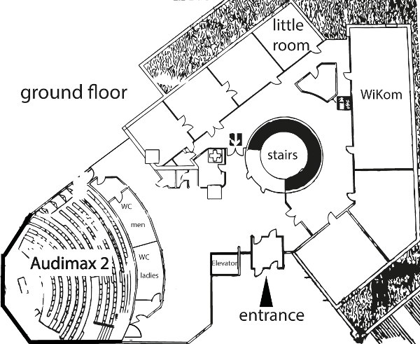

+++
title = "Veranstaltungsort"
+++

## Anreise

<address class="venue-address">
Technische Universität Hamburg (TUHH) 
Gebäude I 
Denickestraße 22 
21073 Hamburg, Deutschland
</address>

[Route zu Gebäude I planen](https://www.openstreetmap.org/directions?to=53.461028%2C9.969921) · [Anreise mit dem HVV planen](https://www.hvv.de/de)

Nutzt die Adresse oben als Ziel und orientiert euch auf dem TUHH-Campus an Gebäude I. Bei Fragen zum Zugang oder zur Barrierefreiheit [kontaktiert das Organisationsteam](@/2026/de/contact.md) bitte vor der Anreise.

<iframe class="venue-map" title="Karte des RoHOW-Veranstaltungsorts an der TU Hamburg, Gebäude I" width="600" height="360" loading="lazy" src="https://www.openstreetmap.org/export/embed.html?bbox=9.955759048461914%2C53.455106375265935%2C9.98408317565918%2C53.46694902448933&amp;layer=mapnik&amp;marker=53.461028112790636%2C9.969921112060547"></iframe>

[Größere Kartenansicht](https://www.openstreetmap.org/?mlat=53.4610&amp;mlon=9.9699#map=16/53.4610/9.9699)

## Gebäudepläne (Gebäude I)

Diese Pläne stammen aus früheren Veranstaltungen und dienen zur Orientierung. Raumbelegung und Zugänge können sich geändert haben. Beachtet die Beschilderung vor Ort und die Hinweise des Organisationsteams.

<figure class="content-image">

<figcaption>Keller · Plan von 2017</figcaption>
</figure>

<figure class="content-image">

<figcaption>Erdgeschoss · Plan aus einer früheren Veranstaltung</figcaption>
</figure>
