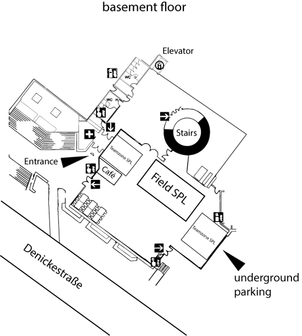
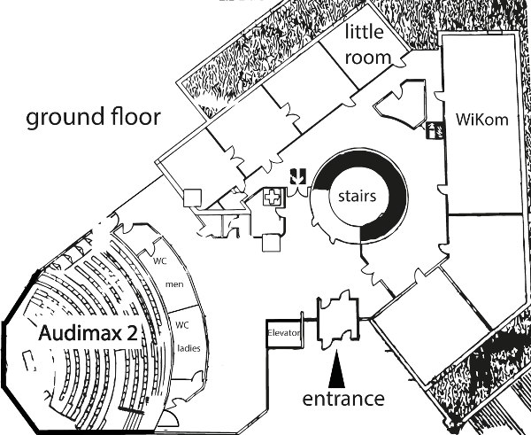

+++
title = "Venue"
+++

## Getting here

<address class="venue-address">
Hamburg University of Technology (TUHH) 
Building I 
Denickestraße 22 
21073 Hamburg, Germany
</address>

[Get directions to Building I](https://www.openstreetmap.org/directions?to=53.461028%2C9.969921) · [Plan your public transport journey with HVV](https://www.hvv.de/en)

Use the address above as your destination and look for Building I on the TUHH campus. For questions about access or accessibility, [contact the organizers](@/2026/en/contact.md) before travelling.

<iframe class="venue-map" title="Map showing RoHOW at TU Hamburg, Building I" width="600" height="360" loading="lazy" src="https://www.openstreetmap.org/export/embed.html?bbox=9.955759048461914%2C53.455106375265935%2C9.98408317565918%2C53.46694902448933&amp;layer=mapnik&amp;marker=53.461028112790636%2C9.969921112060547"></iframe>

[View larger map](https://www.openstreetmap.org/?mlat=53.4610&amp;mlon=9.9699#map=16/53.4610/9.9699)

## Building plans (Building I)

These plans are from earlier events and are provided for orientation. Room assignments and access routes may have changed; follow the on-site signs and organizer guidance.

<figure class="content-image">

<figcaption>Basement · plan from 2017</figcaption>
</figure>

<figure class="content-image">

<figcaption>Ground floor · plan from an earlier event</figcaption>
</figure>
